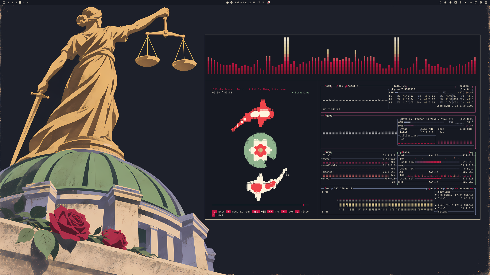
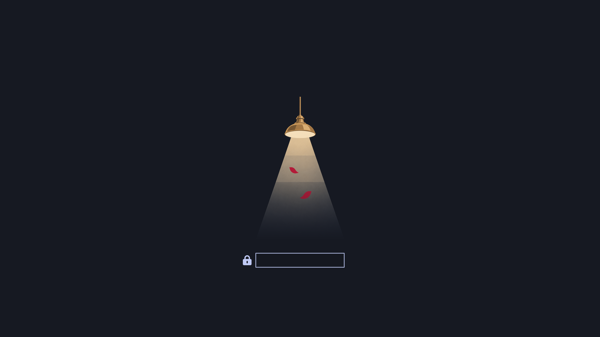
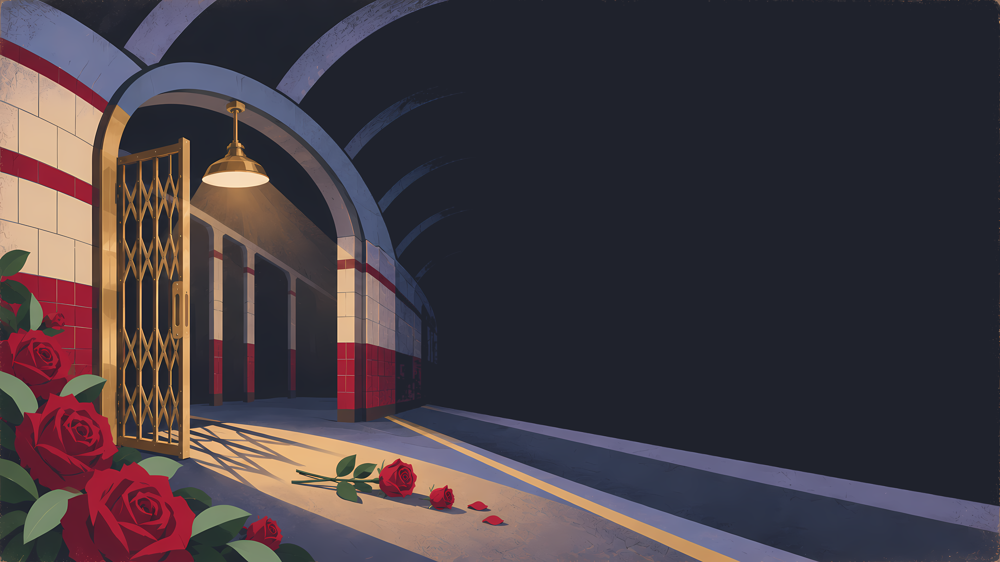
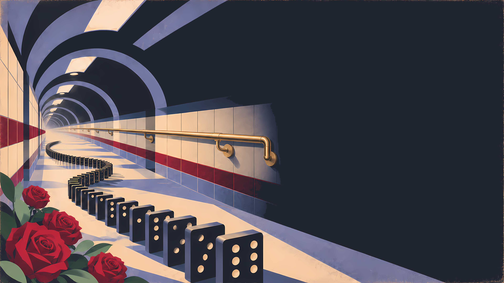
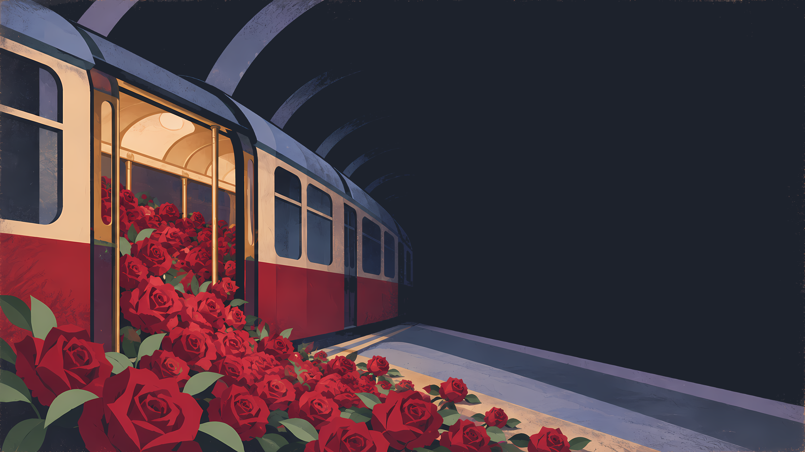
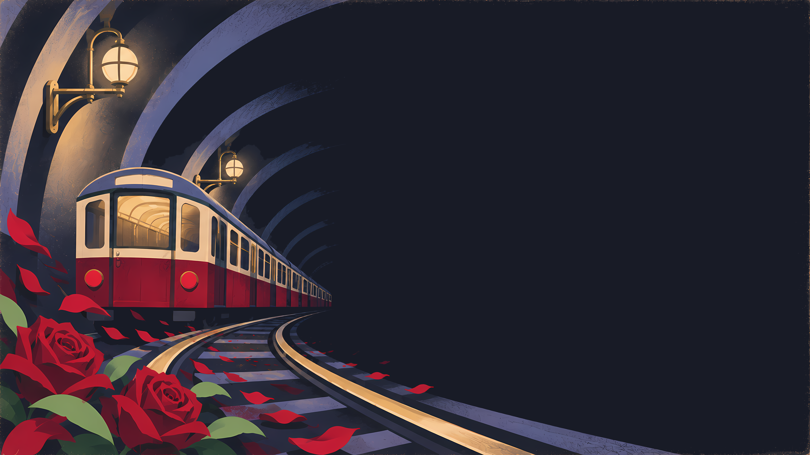
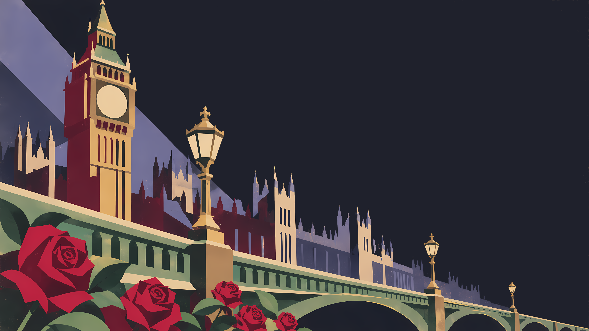
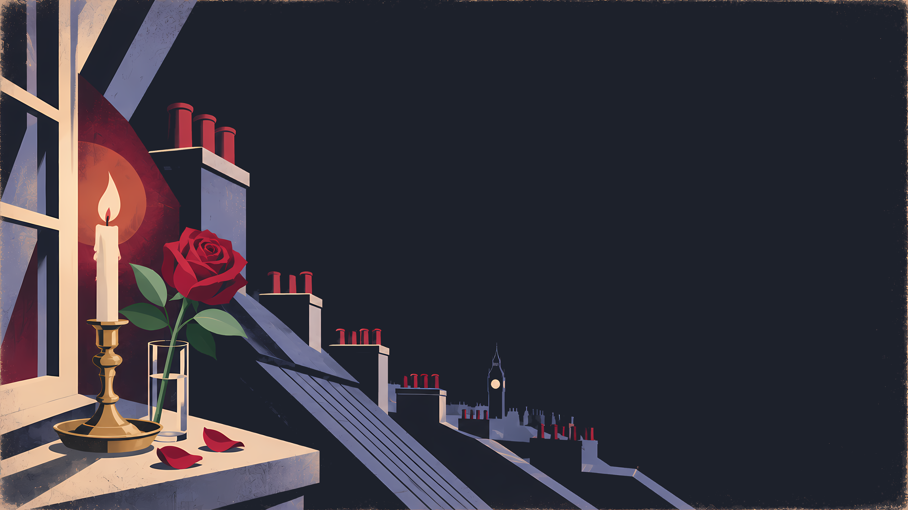

# Scarlet Carson Omarchy Theme

> *Remember, remember the fifth of November,*
> *Gunpowder, treason and plot.*
> *I see no reason why gunpowder treason*
> *Should ever be forgot.*

A night-time London Omarchy theme drawn as 1930s Underground travel posters. A disused station with one lamp still burning, a line of dominoes waiting to fall, a train full of roses, Westminster at night, and the last rose on a rooftop window ledge. The screen is cold blue-black with ivory text, brass for the quiet details and one rose crimson for what needs your attention.

## Preview





## Install

```bash
omarchy theme install https://github.com/Devis99/omarchy-scarlet-carson-theme
```

## What's Included

- Core Omarchy colours, an ivory window border and a matching bar, menu, launcher and popups.
- App themes for Discord (Vencord), GTK, Zen, Zed, btop, cava and cliamp, plus matching icons.
- A Plymouth unlock image of one lit station lamp above the password box.
- A 7-wallpaper set in `backgrounds/`, with a lamp-lighting intro video for the first one.
- The palette as a Base24 scheme in `scarlet-carson-base24.yaml`.

## Palette

The palette comes from a single film frame of red roses at night: a cool blue-black ground, mask-ivory text, rose crimson, wine, brass and the green of the rose leaves, with night lavender for the cool colours. Crimson is used sparingly, on the current workspace and the selected row, so it stays a signal rather than a wash.

## Wallpapers

All wallpapers are 3840x2160, generated with AI (Codex image generation) in the style of 1930s London Underground lithograph posters and upscaled. The theme is released under the MIT License.

<table>
  <tr>
    <td><br><sub>01 Station</sub></td>
    <td><br><sub>02 Dominoes</sub></td>
    <td><br><sub>03 Rose Train</sub></td>
  </tr>
  <tr>
    <td><br><sub>04 Tunnel</sub></td>
    <td><br><sub>05 Westminster</sub></td>
    <td><br><sub>06 Justice</sub></td>
  </tr>
  <tr>
    <td><br><sub>07 Rooftops</sub></td>
    <td></td>
    <td></td>
  </tr>
</table>
